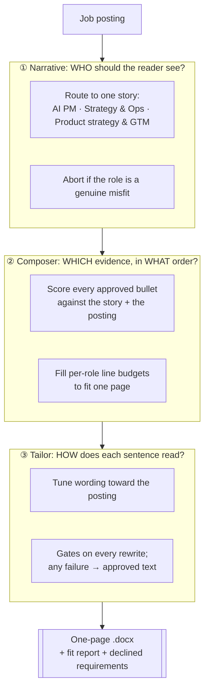

# application-blitz

**Type:** Claude skill (runs in Claude; outputs a .docx resume + fit report)
**Trigger:** `"blitz this role"` + a job link
**Status:** live, first run Nov 2026

## What it does

Turns one job posting into a one-page resume that argues for a single impression, plus an honest report of every requirement it **refused** to claim.

The hard part isn't generating text. It's producing text that is **specific to this role and still true**. Every claim on the page traces back to a bullet I wrote and approved myself. The model may tune wording; it may never add facts.

## Why I built it this way

I tried "tailor my resume to this job" prompts first. They did two things I couldn't accept:

1. **Quiet inflation.** "Supported" became "led". AED 2.8M became "AED 3M". Team scope grew.
2. **Vocabulary polish with no substance.** Swapping synonyms changed nothing about which evidence the reader saw first.

So I split the job into three decisions, in order, because they're different questions.

## The bullet bank

All three layers read from one bank. I built mine by checking two resume versions against my own interview playbooks, which keep what's confirmed separate from what's reconstructed. That exercise alone surfaced **four discrepancies**: two figures that didn't match their source, a starting-revenue baseline that compared two different things, and a job title that differed between versions. Each one would have surfaced in a reference check.

Each bullet carries:

| Field | Purpose |
|---|---|
| ID | Stable reference (e.g. `EXP-3`) |
| Tracks | Which story it supports |
| Text | The approved wording |
| Protected facts | Numbers and scope words that must survive verbatim |
| Status | Approved / pending / cut, so drafts can never reach a resume |

Example (fictional):

> **EXP-3 · AI PM:** Owned the rollout of a recommendation engine to 500K+ customers, aligning data, engineering and vendor teams on integration requirements; revenue per recipient reached 2× control
> *Protected:* 500K+ · 2× control · "owned the rollout" (not "built")

The real bank is private and lives only in my own Claude account.

## Gates: a bad model pass can't make the resume worse

| Gate | Rejects |
|---|---|
| Protected facts | Any rewrite that drops or alters a protected number or scope word |
| No new claims | New numbers, tools, clients, outcomes or team sizes |
| No scope inflation | Verb upgrades (helped → led) or widened scope (one division → company-wide) |
| No unheld titles | Describing me with a job title I haven't held |
| Length | Rewrites more than 10% longer than the approved text |
| Fixed slots | Any change to header, titles, dates, education |

**Any failure falls back to the approved text.** The worst case is my normal resume, never a damaged one.

## Honesty as a feature: the declined list

The skill reports every core requirement it **couldn't truthfully claim**. That list is the most useful output: several declined *core* requirements is real evidence a role is a stretch, and it tells me whether the right move is a cold application or a warm introduction.

From the first real run, for a Strategy & Operations role at an Abu Dhabi AI company:

- ✅ Covered: strategy-to-roadmap work, operating at scale, financial modelling, metrics and experimentation, regional experience
- ⛔ Declined: an engineering degree or hands-on engineering experience (a must-have), architecture discussions on evals/latency/cost, Python, shipped LLM products, pricing and packaging
- Verdict: a stretch on technical requirements, so a warm introduction is worth more than the application itself

## Design decisions

- **Why route to one story first?** A resume that tries to be everything reads as nothing. "For this role, the reader should see me as…" decides what leads the page.
- **Why can the workflow abort?** A tool willing to write anything for anything can't be trusted when it says yes.
- **Why "no unheld titles" as its own gate?** I'm targeting AI PM roles without having held a PM title. The resume shows product work through what I did, not a label I'd have to defend in an interview.
- **Why a bank built from source documents, not from my latest resume?** Resumes drift. Interview prep notes, written while the work was fresh, are a better source of truth, and comparing the two catches errors in both.

## Files

- [`SKILL.template.md`](./SKILL.template.md): the full instructions, with a fictional sample bank

← Back to [ai-career-os](../../)
