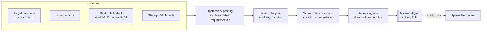

# job-hunter

**Type:** Claude skill (runs in Claude with web search + Google Drive)
**Trigger:** `"hunt"` · `"any new roles?"` · `"hunt Presight"`
**Status:** live, first run Nov 2026

## What it does

Sweeps GCC job sources and the career pages of my target companies for **AI PM, Strategy & Ops and PMM** roles, opens every posting to confirm it's real and open, scores each one for fit, and shows me a ranked digest with a direct link to every role.

Then it **stops**. Nothing reaches my tracker until I reply with the rows I want.

## The problem

Hiring for AI roles in Abu Dhabi and Dubai is spread across LinkedIn, Bayt, GulfTalent, recruiter boards and dozens of company career sites, several of them on different applicant tracking systems. The same role gets copied onto five aggregator sites, and those copies stay up long after the role is filled.

So the expensive part of a GCC job search isn't finding listings. It's figuring out which ones are **real, open, and worth an application today**.

## How it works

## Scoring

`fit = role weight × company weight × freshness × 100`, then adjusted for evidence.

| Role type | Weight | | Company tier | Weight |
|---|---|---|---|---|
| AI PM | 1.00 | | Tier 1: applied / enterprise AI (Abu Dhabi) | 1.00 |
| Strategy & Ops | 0.85 | | Tier 2: AI-forward consumer tech & payments | 0.85 |
| Other PM | 0.80 | | Tier 3: watchlist | 0.70 |
| PMM | 0.70 | | Not on list | 0.60 |

**Freshness** runs from 1.00 (posted this week) down to 0.40 (older than 60 days). Applying early matters more than applying perfectly.

**Evidence adjustments:** +5 when the posting asks for what I've actually done (personalization, experimentation, customer data, recommendation systems), +5 for regional market experience, −10 for hard requirements I can't meet (Arabic fluency, hands-on ML engineering). Penalties are flagged, never hidden: a stretch role still shows up, labelled as a stretch.

## Design decisions

- **Open every posting before scoring it.** In the first test run, 4 of the 9 promising roles turned out to be filled, expired, or deleted, even though they still appeared on job boards. Scoring from search snippets would have sent me to apply for jobs that no longer existed. Verification is now a hard rule, and the official page wins any conflict.
- **Review-first, not auto-write.** A tracker is a record of decisions. If the tool writes to it automatically, it fills with half-relevant rows, and everything downstream (resume tailoring, outreach) starts working from noise.
- **Max two roles per company.** Three applications to one company reads as spray. One well-matched application plus a warm introduction converts better.
- **Strategy & Ops is a first-class track, not a fallback.** In Abu Dhabi's AI companies, strategy-and-operations roles sit right next to product leadership, and they're often a faster path in for an MBA with a commercial background.
- **No scraping behind logins.** It uses public search and public postings only.
- **Never invent a link.** A role without a working link to its posting is not listed.

## Output

See [`example-output.md`](./example-output.md) for a real digest from the first run.

## Files

- [`SKILL.md`](./SKILL.md): the full instructions Claude follows (sources, weights, rules)
- [`example-output.md`](./example-output.md): first-run digest

## What I'd build next

- Run automatically twice a week, with a "new since last run" view
- Track which sources produce roles I actually apply to, and reweight sources based on that
- Hand top picks straight to [`application-blitz`](../application-blitz/) and [`networking-scout`](../networking-scout/)
